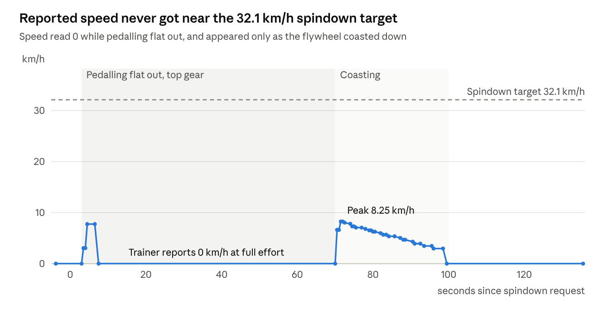
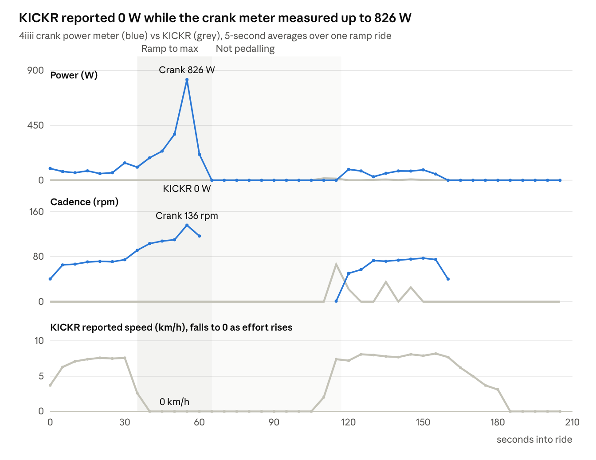

# Wahoo KICKR v5 Support Evidence: Speed Sensor Dropout

Nov 3, 2026 · Josh Peak

> Copy of the support evidence document submitted to Wahoo. The serial number is redacted in this public copy.

## Summary

My KICKR v5 reports 0 W power and 0 rpm cadence on every channel, even though the flywheel spins normally. Speed reads only below about 8 km/h and drops to 0 above that.

I captured both Bluetooth services and both ANT+ profiles directly from the trainer, with no Zwift or Wahoo app connected. All four channels report the same wrong values, which rules out the app, the PC and the radio link. The fault is in the trainer's own measurement.

A spindown requested over ANT+ FE-C never completed. The trainer reported "speed too low" for over two minutes against its 32.1 km/h target, while I pedalled hard. The belt and flywheel are mechanically fine, and resistance control works. I believe the flywheel speed sensor, or its wiring or signal path, has failed.

An independent 4iiii crank power meter confirms this. It recorded up to 1,038 W and 159 rpm during a ramp, while every KICKR channel reported 0 W and 0 rpm (Evidence 4).

## Device details

| Field | Value | Source |
| --- | --- | --- |
| Model | KICKR v5 (2020) | Owner |
| Bluetooth name | Wahoo KICKR 9B08 | BLE advertisement |
| Serial number | (redacted) | BLE Device Information |
| Firmware | 4.5.74 | BLE Device Information |
| Hardware revision | 6 | BLE Device Information, ANT+ page 80 |
| ANT+ device number | 39688 | ANT+ channel ID |
| ANT+ manufacturer / model | 32 (Wahoo) / 1 | ANT+ page 80 |

## Symptoms

- At a real cadence of 110+ rpm, Zwift shows 20–40 rpm briefly, then 0 rpm.
- Speed and power do the same: a low reading, then 0.
- The trainer is detected and pairs normally over Bluetooth and ANT+.
- The flywheel spins normally and the belt does not slip.
- The Wahoo app can still change resistance.

## Test method

I ran a custom logger on a Mac that records every packet from the trainer, raw bytes plus decoded values, with timestamps. Zwift and the Wahoo app were closed.

| Channel | Link | Data captured |
| --- | --- | --- |
| Cycling Power Measurement (0x2A63) | Bluetooth | Power, cumulative wheel and crank revolutions with event times |
| FTMS Indoor Bike Data (0x2AD2) | Bluetooth | Speed, cadence, power |
| ANT+ FE-C (device type 17) | ANT+ USB stick (Dynastream) | Pages 16, 25, 26, calibration pages 1 and 2 |
| ANT+ Power (device type 11) | ANT+ USB stick (Dynastream) | Pages 16, 17 |

The raw logs (JSON lines, one packet per line) are available on request.

## Evidence 1: every channel reports 0 W and 0 rpm

In 120 seconds of steady pedalling, every power and cadence sample on all four channels was 0. The Bluetooth wheel-revolution counter advanced only 6 revolutions in that time. With the flywheel spinning normally it should have advanced by hundreds.

| Channel | Samples | Power (W) | Cadence (rpm) | Max speed (km/h) |
| --- | --- | --- | --- | --- |
| BLE Cycling Power | 120 | 0 in all | 0 (crank counter frozen at 41) | 5.2 |
| BLE FTMS | 120 | 0 in all | 0 in all | 5.2 |
| ANT+ FE-C | 85 (page 25) | 0 in all | 0 in all | 5.2 |
| ANT+ Power | 101 (page 16) | 0 in all | 0 in all | n/a |

Notification rates were steady (about 1 Hz on Bluetooth and 4 Hz on ANT+), with no gaps or disconnects. The trainer is sending data on time. The data itself is wrong.

## Evidence 2: spindown never reached target speed

*ANT+ FE-C page 16 speed, captured 2026-11-03 · phase boundaries from the rider's account and the first non-zero coast-down reading*

The trainer accepted the ANT+ FE-C spindown request (page 1, 0x80). It then reported "speed condition: too low" on all 211 calibration progress pages over 134 seconds, and never sent a result. I was in the highest gear, pedalling as hard as I could, which is well above 32 km/h on a working trainer. Bluetooth CPS, FTMS and ANT+ reported identical speeds throughout.

## Evidence 3: raw sensor page frozen, status flags set

- **The FE-C trainer torque page (page 26) never changed.** It read event count 2, wheel ticks 2 and wheel period 11985 across the whole session, including the coast-down when speed was reported.
- **Resistance calibration required: set.** In page 25 trainer status, on every sample.
- **User configuration required: set.** On every sample.
- **Power calibration required: not set.**
- **FE state was mostly "finished"** rather than "in use" while I was pedalling.

Two minor firmware quirks were also seen. They are probably unrelated, but are included for completeness:

- **Cycling Power Feature (0x2A65) returns 2 bytes** (`0e12`) instead of the 4 the Bluetooth spec requires.
- **Training Status (0x2AD3) returns `76dd`.** The status byte 0xDD is outside the defined FTMS range.

## Evidence 4: independent crank power meter as true reference

*BLE capture 2026-11-03, 23:40–23:44 · 4iiii105 Cycling Power vs KICKR CPS power, ANT+ FE-C cadence and speed · 5 s bins*

I rode steadily, ramped to maximum effort, stopped, then rode steadily again. A 4iiii crank power meter (zero-offset calibrated just before) recorded the rider's real output at the same time as the KICKR.

| During pedalling (156 s) | 4iiii crank meter | KICKR |
| --- | --- | --- |
| Peak power (single sample) | 1,038 W | 82 W |
| Mean power | 152 W | 1.6 W |
| Samples reading 0 W | 30 of 160 (pedal-stroke gaps) | 134 of 156 |
| Peak cadence (single sample) | 159 rpm | 70 rpm (isolated) |
| Samples reading 0 rpm | 0 of 133 | 100 of 107 |
| Peak speed | n/a | 8.5 km/h |

Even during gentle riding at 55–90 W and 65–75 rpm, the KICKR reported 0 W and 0 rpm, and speed was stuck near 7.5 km/h. When cadence passed about 90 rpm in the ramp, KICKR speed fell to 0 and stayed there through the 826 W peak. The 4iiii is a left-only meter that doubles left-leg power, so its watts are approximate, but its cadence is direct.

## Already ruled out

| Suspect | Ruled out by |
| --- | --- |
| Zwift or other app | Fault reproduced with no app connected, on a custom logger |
| Bluetooth link or interference | ANT+ shows identical values; no packet gaps or disconnects |
| Drive belt | Inspected; not slipping |
| Flywheel | Spins normally under pedalling |
| Resistance unit | Wahoo app can still command resistance |
| Calibration | Spindown cannot run, because the trainer cannot see its own speed |
| Rider not producing power | Independent 4iiii crank meter recorded up to 1,038 W and 159 rpm (Evidence 4) |
| Stuck connection or control chip | Unplugged for 30-35 seconds and moved to a different power outlet; no change |
| Wheel circumference setting | Speed calculated from the trainer's own wheel-revolution counter at 2,105 mm matches its reported speed to 0.01 km/h, so the stored circumference is the 2,105 mm default |
| Outdated firmware | 4.5.74 installed, the latest KICKR v5 release |

Every step in Wahoo's article [KICKR is connected, but there is no power or cadence data, and speed is intermittent < 12 mph](https://support.wahoofitness.com/hc/en-us/articles/115000510424-KICKR-is-connected-but-there-is-no-power-or-cadence-data-and-speed-is-intermittent-12-mph) has been completed without resolving the fault. The symptom in its title matches this unit exactly.

## Request

1. Please confirm whether this matches a known flywheel speed sensor fault on KICKR v5 hardware revision 6.
2. Please advise on a repair or replacement for the sensor, or the unit.
3. If you'd like a firmware re-flash or factory reset tried first, please send the steps. I'll repeat the capture and send the before-and-after logs.
